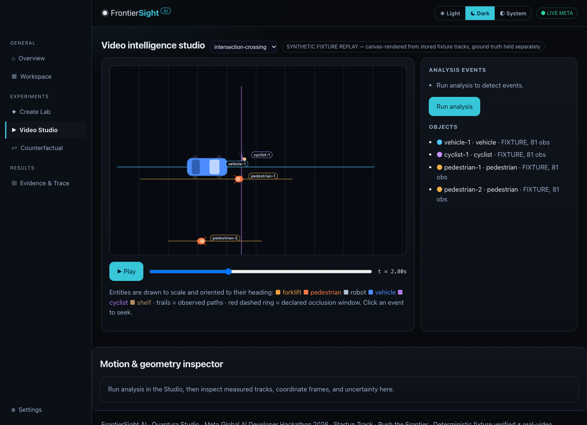
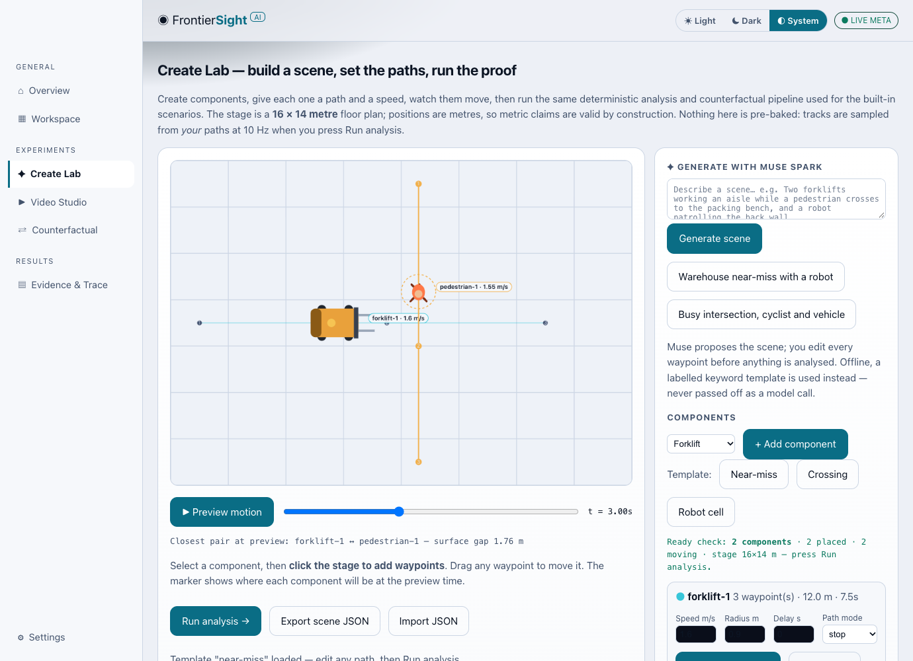
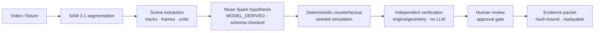
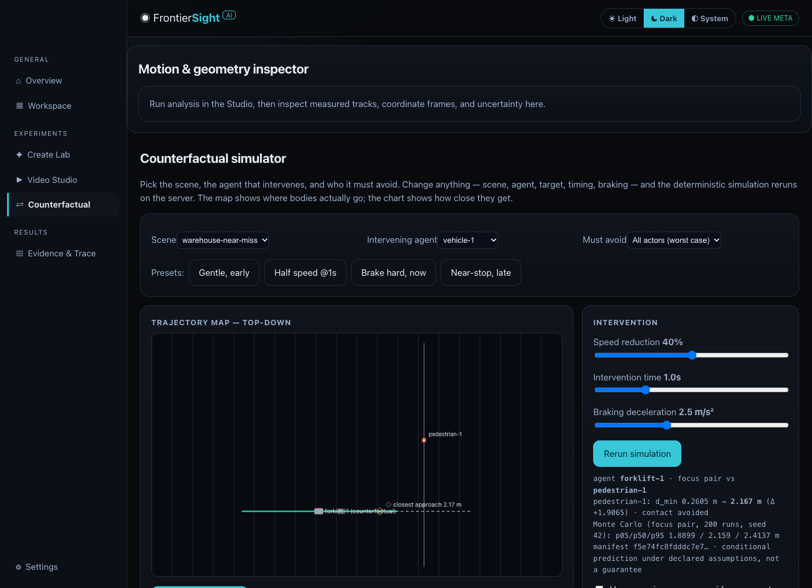

<p></p>

# FrontierSight AI

**From video to verifiable physical-world intelligence.**

[](https://github.com/tamzid2001/frontiersight-ai/actions/workflows/ci.yml)
[](LICENSE)
[](pyproject.toml)
[](https://frontiersight-ai.vercel.app)

Built for the **Meta Global AI Developer Hackathon 2026** — Indie Track, Theme 2: *Push the Frontier*.
Owner: **Quantura Studio**. Submissions close **Nov 4, 2026, 9:00 PM ET**.

> Video models can tell you a forklift "nearly hit" a pedestrian. FrontierSight makes them prove it:
> **SAM 3.1 sees, Muse Spark reasons, and an independent deterministic physics engine decides** —
> with a human approving the evidence before it leaves the building. Every number carries its
> provenance: `MODEL_DERIVED`, `DETERMINISTIC`, `FIXTURE`, or `ASSUMPTION`.

## Watch it (3 minutes)

[](https://youtu.be/mYTkPqigoz8)

**Demo video:** https://youtu.be/mYTkPqigoz8 · **Live app:** https://frontiersight-ai.vercel.app



## Quickstart (60 seconds, no keys, no build step)

```bash
git clone https://github.com/tamzid2001/frontiersight-ai && cd frontiersight-ai
python3 -m pytest -q                                     # 42 tests, fully offline
PYTHONPATH=. python3 -m services.api.server --port 8000  # → http://127.0.0.1:8000
```

Runtime dependencies: **none** (Python ≥3.10 standard library). Docker also works: `docker compose up`.

Add a Meta Model API key (server-side only) to unlock live AI features:

```bash
cp .env.example .env   # MODEL_API_KEY=…  META_MODEL=muse-spark-1.3  META_SAM_MODEL=sam-3.1
```

Without a key, everything runs in honestly labelled `FIXTURE_REPLAY` mode — no segmentation or
model call is ever claimed that didn't happen.

## What you can do

| Workflow | Where | What happens |
|---|---|---|
| Analyse a built-in scenario | Video Studio | 5 scenarios (near-miss, safe passing, occlusion, 5-entity warehouse, 4-user intersection), playable canvas, event list that seeks the player, all-pairs inspector |
| Build your own scene | Create Lab | Add forklifts/pedestrians/robots/vehicles/cyclists/shelves, click to lay waypoint paths, drag to edit, speed/radius/delay per component, stop/loop/ping-pong modes, templates, share links |
| Generate a scene from a sentence | Create Lab → ✦ | Muse Spark designs the scene as strict JSON; schema-validated before it touches the editor, fully editable afterwards |
| Test a counterfactual | Counterfactual | Scene/agent/target pickers, braking presets + deceleration control, top-down trajectory map (original vs counterfactual), separation chart with contact band, Monte-Carlo intervals |
| Audit the reasoning | Evidence & Trace | 9-stage bounded agent workflow with per-stage attribution and artifact hashes; export a hash-bound evidence packet (JSON/HTML) |
| Segment real imagery | API (`/api/meta/segment`) | SAM 3.1 over the documented special-token wire format — boxes, stable ids, confidences parsed live |



## How it works



**The trust rule that defines the product:** an LLM may *propose* and *explain*, but every physical
claim is either computed by seeded deterministic code (with analytical reference cases), or
explicitly labelled as model-derived, fixture, or unsupported assumption. If a scene has no
calibration, the engine stays in pixel space and **refuses to fabricate metres**.

### The deterministic engine (`engine/`)

- **Geometry** — constant-velocity closest point of approach; exact quadratic time-to-collision
  (zero-velocity, separating, and miss cases return honest `None`, never a fake number).
- **Kinematics** — finite-difference speeds/accelerations over real timestamps, irregular sampling
  handled; calibration gating (metric claims only with a declared scale).
- **Tracking** — continuity diagnostics: trajectory jumps, possible identity switches across
  occlusions, implausible accelerations; occlusion windows reported as *missing evidence*,
  separately from numerical uncertainty.
- **Counterfactual** — braking-agent simulation vs. every other actor, seeded Monte Carlo over
  initial-position uncertainty (p05/p50/p95), SHA-256 hash-bound result manifests. Same inputs →
  same outputs, bit for bit.
- **Validation** — 7 independently authored analytical cases (head-on TTC = 4.5 s exactly,
  crossing CPA, delayed braking, invalid-input rejection) run in CI on every push.



## Meta AI integration — verified live, not claimed

| Model | Role | Verified |
|---|---|---|
| `muse-spark-1.3` | Scene interpretation, schema-validated counterfactual hypotheses, narration of deterministic findings | ✅ Real calls recorded: latencies, token usage, response ids in [`docs/LIVE_META_VERIFICATION.md`](docs/LIVE_META_VERIFICATION.md) |
| `sam-3.1` | Image segmentation; boxes/stable ids/confidences parsed from the documented wire grammar | ✅ Real responses parsed (confidences 0.57–0.97); honest zero-match on primitive synthetic shapes also recorded |
| `muse-image-1.0` | Clearly-labelled illustrative visuals only | ✅ Generated frames used as SAM test inputs; never presented as evidence |

Base URL `https://api.meta.ai/v1`, Bearer `MODEL_API_KEY` (server-side only, never sent to the
browser) — per the official [Meta Model API docs](https://dev.meta.ai/docs).

## Honest labels (kept separate in every evidence report)

- `deterministic_fixture_verified` — yes (42 tests + 7 analytical validation cases, CI green)
- `meta_api_integration_verified` — yes, measured (see above)
- `real_video_evaluation_completed` — **not yet**; SAM video-mode tracking on real industrial
  footage is API-integrated but unbenchmarked
- `hardware_validation` — unavailable · **No physical safety certification is claimed**

Full limitations: [`LIMITATIONS.md`](LIMITATIONS.md). Deep code review (2,154 lines, WCAG
contrast audit, all findings): [`docs/CODE_REVIEW_2.md`](docs/CODE_REVIEW_2.md).

## Project layout

```
frontiersight-ai/
├── apps/web/            workbench UI (Overview, Workspace, Create Lab, Studio,
│                        Counterfactual, Evidence & Trace, Pricing, Settings)
├── services/api/        zero-dependency HTTP API (local + Vercel serverless)
├── engine/              deterministic geometry, kinematics, tracking, uncertainty,
│                        counterfactual simulation, analytical validation, scenarios
├── agents/              bounded 9-stage workflow (roles, idempotency, approval gate)
├── integrations/meta/   Muse Spark · SAM 3.1 (+ wire-format parser) · Muse Image
├── fixtures/            5 synthetic scenarios, ground truth held separate from observations
├── tests/               engine, SAM parser, workflow, uploads, API + regression gates
├── scripts/             fixture generator, live Meta verification harness
└── docs/                compliance, audits, UI research, live verification, submission
```

## Testing

```bash
python3 -m pytest -q        # unit/property/integration-style API tests (42)
PYTHONPATH=. python3 -m services.api.server --smoke   # health + UI smoke
```

CI (GitHub Actions, Python 3.10 + 3.12) runs tests, CLI demo, API smoke, and a
secret-pattern scan on every push.

## Deployment

Deployed on Vercel as a zero-dependency Python serverless function:
https://frontiersight-ai.vercel.app — deployed state, live latency, and end-to-end
browser audits (39 checks: theming, auth, pricing, share links, prompt-to-scene,
analysis flows, mobile) are run against production after each release.

## Auth & pricing (accurate for this build)

- **Sign-in** in this build creates *device-local profiles* (browser storage; no server
  account, no password) — labelled as such in the UI. The production path
  (Clerk/OIDC + server sessions + Postgres) is designed in
  [`docs/AUTH_AND_BILLING.md`](docs/AUTH_AND_BILLING.md).
- **Pricing** tiers are planned launch prices shown in-app; **billing is not enabled**,
  the waitlist collects no payment, and Meta API usage in production is billed by Meta
  under your own key.

## Hackathon submission

- [`docs/HACKATHON_SUBMISSION.md`](docs/HACKATHON_SUBMISSION.md) — problem, novelty, judging map
- [`docs/HACKATHON_COMPLIANCE.md`](docs/HACKATHON_COMPLIANCE.md) — rules, dates, IP method
- [`docs/PRIVATE_RESEARCH_AUDIT.md`](docs/PRIVATE_RESEARCH_AUDIT.md) — how prior private
  research informed concepts **without any code being copied** (licence status verified first)
- [`docs/DEMO_SCRIPT.md`](docs/DEMO_SCRIPT.md) — the 90-second demo flow behind the video

## Contributing & security

Run the test suite and API smoke before opening a PR; keep deterministic code in `engine/`
free of model calls and model code behind `integrations/meta/` with schema validation.
Never relabel fixture output as live. See [`CONTRIBUTING.md`](CONTRIBUTING.md) and
[`SECURITY.md`](SECURITY.md). In-app legal: Terms of Service and Privacy Policy are linked
in the footer of the live site.

## License

MIT — original work written for this hackathon. See [`LICENSE`](LICENSE).
